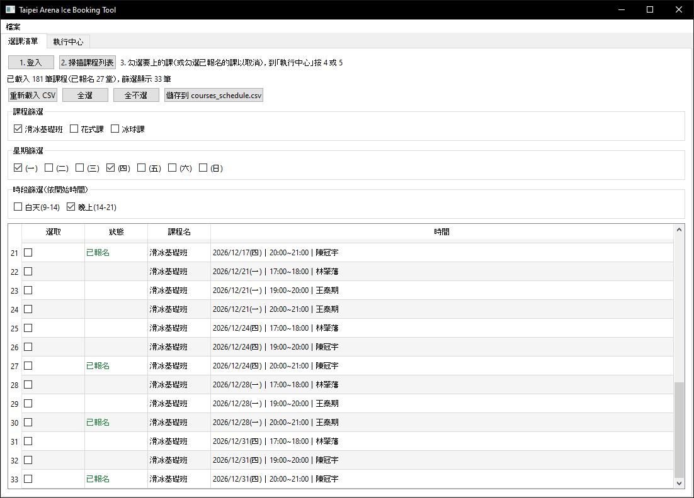
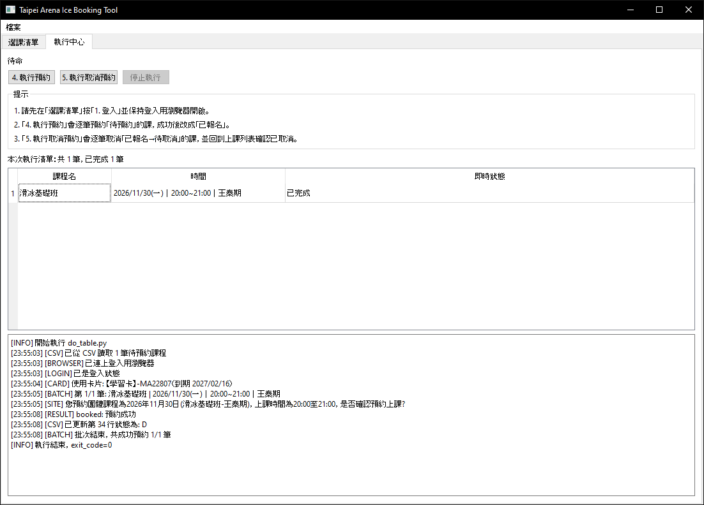

# 台北小巨蛋冰上樂園課程批次預約工具（GUI + 自動化）

此專案用於在[台北小巨蛋冰上樂園學員系統](https://ssl.metro.taipei/TAPICELand/Student/Login.aspx)批次預約團體課程，提供 GUI 操作，不需要一堂一堂重複執行選課與確認的動作。

核心能力：
- 從預約頁抓取團體課程表（日期、時間、課程、教練），並檢查是否已報名
- 用 `courses_schedule.csv` 進行批次預約與取消預約
- `V` 待預約、`D` 已報名、`X` 待取消（執行後會自動更新）
- 全自動執行（不需逐筆確認）
- 執行前自動同步「選課清單」當前勾選狀態到 CSV

## 主要檔案

- `app.py`
  - PySide6 GUI 主程式
  - 提供「選課清單 / 執行中心」
- `metro_site.py`
  - 學員系統共用操作：連接登入用瀏覽器、確認登入、選擇卡片、解析課程表
- `scan_courses.py`
  - 進入「課程預約」頁抓取課程表，更新 `courses_schedule.csv`
- `do_table.py`
  - 依 `courses_schedule.csv` 逐筆執行：`狀態=V` 在網站按「可預約」預約；`狀態=X` 按「取消預約」取消
  - 預約成功改成 `D`；取消成功後清除狀態
- `courses_schedule.csv`
  - 執行時產生的本機資料（不納入版本控制）
  - 欄位：`狀態,課程名,時間`
  - `時間` 格式：`2026/11/26(四)｜17:00~18:00｜教練名`

## 狀態規則

- 空白：未排程
- `V`：待預約（勾選未報名的課）
- `D`：已報名（以掃描時上課列表的「取消預約」按鈕為準，或本工具預約成功）
- `X`：已報名、勾選待取消（勾選已報名的課）

## 環境需求

- Windows
- Python 3.11+
- 小巨蛋冰上樂園學員帳號，且有可預約的課程卡或學習卡

## 使用流程

1. **登入**：在「選課清單」按 `1. 登入`，程式會開啟瀏覽器並進入登入頁。請手動輸入帳號、密碼、驗證碼並按「登入」（有圖片驗證碼與 Cloudflare 人機驗證，無法自動登入）。登入後請**保持這個瀏覽器開啟**。
2. **掃描課程列表**：按 `2. 掃描課程列表`，程式會在登入用瀏覽器開新分頁：
   - 到「課程預約」頁，卡片種類選最上方（全部）並查詢
   - 有兩張以上可預約的卡片時，選到期日期最晚的那張（同到期日再比購買日期）
   - 進入上課列表並寫入 `courses_schedule.csv`，完成後關閉該分頁
   - 同時檢查是否已報名：上課列表中按鈕為「取消預約」的課程標成 `D`（顯示「已報名」，不能再勾選）；原本是 `D` 但已不是報名狀態（例如已取消）會清空
   - 完成後會跳出已報名課程清單
3. **勾選課程**：在表格勾選要上的課（可用課程、星期、時段篩選）。要取消已報名的課，就勾選該課（狀態顯示「已報名→待取消」）。「全選」只會勾選未報名的課。
4. **執行預約**：到「執行中心」按 `4. 執行預約`，依勾選逐筆預約。
5. **取消預約**：到「執行中心」按 `5. 執行取消預約`，逐筆取消「待取消」的課：
   - 在上課列表按該課的「取消預約」，再按網站確認視窗的「確認」
   - 網站的取消結果視窗一律顯示成功圖示，因此程式會回到上課列表再確認該課已不是報名狀態，才清除標記
   - 超過最晚取消日期等原因取消失敗時，保留「待取消」並在 Log 顯示網站訊息

說明：
- 「掃描課程列表」「執行預約」「執行取消預約」都透過遠端除錯埠（預設 `9333`，可用環境變數 `BOOKING_DEBUG_PORT` 調整）接上登入用瀏覽器，沿用同一個登入狀態，結束時只關閉自己開的分頁。
- 若登入已失效，程式會在分頁中開啟登入頁並等待重新登入（預設最多 600 秒，可用環境變數 `BOOKING_LOGIN_WAIT_SEC` 調整）。
- 瀏覽器 profile 存放在 `browser_profile/`。舊版使用的 `google_profile/`、`google_profile_playwright/` 已不再使用，可自行刪除。

## 安裝與啟動

執行：

```bat
0_run.bat
```

會先安裝／更新必要套件，再啟動 GUI，內容等同：

```bat
pip install playwright
pip install pyside6
playwright install chromium
python app.py
```

已安裝過套件時，也可以直接執行 `python app.py` 啟動。GUI 啟動時會檢查 `playwright` 與 Chromium，缺少時可選擇自動安裝。

## GUI 使用方式

### 選課清單頁

- `1. 登入`：開啟（或沿用）登入用瀏覽器並進入登入頁
- `2. 掃描課程列表`：執行 `scan_courses.py` 抓取課程表
  - 掃描前會先儲存目前勾選，掃描後保留相同課程原本的勾選狀態
- 可勾選課程並儲存到 CSV
- 支援篩選：
  - 課程勾選（可多選）：`滑冰基礎班`、`花式課`（花式初級班＋花式進階班）、`冰球課`（冰上曲棍球初級班＋進階班）
  - 星期勾選 `(一)~(日)`
  - 時段勾選（依課程開始時間）：`白天(9-14)`、`晚上(14-21)`
  - 篩選只影響顯示；CSV 與預約仍使用網站上的原課程名

### 執行中心頁

- `4. 執行預約`
  - 需先完成 `1. 登入`
  - 執行前會先同步「選課清單」當前勾選結果到 `courses_schedule.csv`
- `5. 執行取消預約`
  - 取消「選課清單」中勾選的已報名課程（狀態 `X`）
- 執行結束後「選課清單」會自動重新讀取 CSV
- 全自動執行，不會跳確認視窗
- 顯示本次執行清單與即時狀態
  - 待執行 / 執行中 / 已完成
- Log 即時顯示，不需等待腳本結束

## 預約流程

每一筆 `狀態=V` 的課程：

1. 回到「課程預約」頁並重新讀取課程表
2. 依「課程名 + 時間（日期、時段、教練）」找到該堂課
   - 找不到、或狀態不是「可預約」（例如額滿、暫停預約）時略過，保留 `V`
   - 網站顯示「取消預約」代表已預約過，直接標成 `D`
3. 按「可預約」，再按網站確認視窗的「確認」
4. 讀取網站回傳的結果，成功才標成 `D`；失敗會在 Log 顯示網站訊息

## 介面截圖

### 主畫面



### 執行中心



## 常見問題

- 按「掃描課程列表」「執行預約」或「執行取消預約」時提示尚未登入
  - 請先按 `1. 登入`，並保持登入用瀏覽器開啟（關閉瀏覽器後登入狀態會消失）

- 沒有可執行課程
  - 檢查 `courses_schedule.csv` 是否有 `狀態=V`
  - 舊版（Google 表單）產生的 CSV 格式不同，請先按 `2. 掃描課程列表` 重新產生

- 預約時顯示找不到課程
  - 團體課程於每月 20 號開放次月預約，尚未開放的課程不會出現在預約頁
  - 請重新 `2. 掃描課程列表`，確認課程時間與教練是否有變更

- 找不到可預約的卡片
  - 「課程預約」頁沒有任何卡片顯示「預約」按鈕（例如卡片過期或剩餘堂數為 0）
